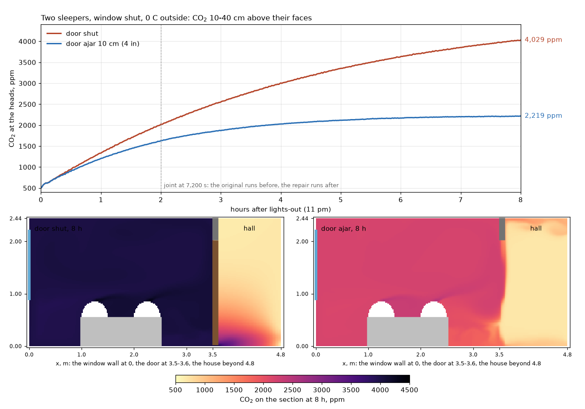

# A bedroom door shut or ajar on a winter night, and the CO2 two sleepers breathe out

Two people go to sleep at 11 pm in a bedroom off the upstairs hall, the window shut on a 0 °C (32 °F) night. One camp
says to shut the door: "Sleep with the bedroom door closed" (Steve Kerber of UL's Fire Safety Research Institute, whose
"Close Before You Doze" tests found a closed bedroom under 100 °F while the open-door rooms passed 1,000 °F). The other
camp says to leave it open or ajar for the air: "keeping your bedroom door ajar at night helps you sleep deeper" (Tom's
Guide), on the strength of sleep studies such as Mishra et al. (2018), who measured 717 ppm of CO2 with a window or the
door open against 1,150 ppm with both shut. The two camps answer different questions. This case answers only the second:
how much of the CO2 the sleepers breathe out is still round their heads by morning with the door shut, and with it ajar
by 10 cm (4 in). It says nothing against shutting the door for fire, and nothing about health.

    ./Allrun shut      # the leaf shut: a 12 mm undercut and 3 mm gaps round it, 0-28,800 s (8 h)
    ./Allrun ajar      # the leaf open 10 cm at the latch, 0-28,800 s

**The result.** **With the door shut the CO2 at the sleepers' heads keeps climbing all night, to 4,029 ppm by 7 am; with
it ajar it levels off near 2,200** (2,219 at 8 h). Both rooms start at 500 ppm at lights-out and part slowly: 945
against 898 ppm at 30 minutes, 2,021 against 1,631 at 2 h, 3,006 against 2,028 at 4 h. The ajar door trades 3.6-3.8 L/s
of air each way on average in every hour after the first, the bedroom's cooler air going out low and the hall's coming
in high; the shut door 0.13-0.16 L/s, out under the undercut and in over the head. The bedroom sits 0.37-0.40 K under
the hall from the first hour in both, its window and outside wall losing about 82 W to the cold against the sleepers'
100 W and the house's warmth through the floor. Read [What it cannot](#what-it-cannot) before any number here: **it is a
2-D section**, in which the ajar gap's narrow jet is spread over the room's depth and only its exchange is kept; **the
shut room's 4,029 is on the high side**, because the leakage through its walls and window (0.20 air changes an hour) is
ours and not measured, and its section has about 7% less air than a real room; **the night is still and steady**, with
no wind, no forced-air heating, no breaths and nobody turning over; and there is one mesh a run.

**The published results join two solves at 7,200 s.** The runs first solved lost some walls' heat-transfer coefficients
when they were restarted at 2 h, so they are valid only to 7,200 s; both nights were then solved again from their 7,200
s state with the coefficients restored. `results/` is the first runs' 0-7,200 s and the repair runs' 7,200-28,800 s,
continuous at the joint (the heads 2,020.95 to 2,021.03 ppm shut and 1,630.83 to 1,630.83 ajar across it, the next
monitor row 0.09 s later). The fault was in how OpenFOAM v2512 writes these coefficients on a restart, and this case
carries the repair's fix (`src/restartSafeConstant`, loaded from the first step), so a run of this folder keeps them
through every restart; see [The restart and its fix](#the-restart-and-its-fix).

*Top: the CO2 at the heads (10-40 cm above both faces), from `results/<run>/history.csv`. Below: the section's air cells
at 8 h, from `scripts/plot_results.py`, the window on the left (blue), the bed and the two sleepers' humps, the door
wall at 3.5-3.6 m (the shut leaf brown) and the hall open to the house at 4.8 m. With the door shut the bedroom's CO2
leaves mostly under the undercut and runs along the hall floor.*

## The room

A vertical section across the bed through the sleepers' faces, seen from the foot of the bed, one cell deep. Everything
is per metre of the room's depth; the real room is 3.5 m deep, so flows and heat are given here times 3.5. x runs from
the outside wall's inner face (x = 0) across the room, y up from the floor; metres.

| | value | from |
|---|---|---|
| bedroom | x 0-3.50, y 0-2.44 (8 ft), 3.5 m deep: 29.9 m³ less the bed and the sleepers, which a section carries through the whole depth: **26.1 m³ of air** (7.4546 m³ per metre) | ours |
| window | in the outside wall from y 0.90 to 2.20, 1.2 m wide in the real wall: spread over the depth, that band has the area-weighted U of 0.81 W/m²K (34% glazing at U 1.70, the rest wall at 0.34) to 0 °C outside | IECC 2021, climate zone 5 |
| outside wall | the rest of x = 0, U 0.34 W/m²K to 0 °C | IECC 2021, climate zone 5 |
| floor, ceiling, door wall (and the hall's floor and ceiling) | U 1.5 W/m²K to the house at 18 °C (an inner floor or partition) | ours |
| bed | a queen, x 0.98-2.52, frame and mattress a solid block to y = 0.55, adiabatic | ours |
| sleepers | two humps of head and duvet-covered shoulders on their backs, x 1.00-1.50 (the man, window side) and 2.00-2.50, each 0.50 m wide and up to 0.30 m above the mattress; **each gives the air 50 W** through its surface (about 70% of a sleeping adult's 72 W, the rest going in moisture and radiation) | 72 W: ASHRAE; the split ours |
| breath | each breathes its CO2 into a 10 x 5 cm zone over its face (x 1.20-1.30 and 2.20-2.30, y 0.85-0.90): **0.00384 L/s (the man) and 0.00298 L/s (the woman)**, a man and a woman of 30 to 40 asleep at 0.95 met, at 18 °C | Persily and de Jonge (2017), Table 4 and Eq. 11 |
| door wall | x 3.50-3.60, the doorway from the floor to y = 2.03 (a 0.80 x 2.03 m door, 32 x 80 in) | ours |
| hall | x 3.60-4.80, y 0-2.44, open at x = 4.80 to the landing and the rest of the house | ours |
| the house | a reservoir at 18 °C (the night set-back) in hydrostatic balance: x = 4.80 is a total pressure at each face's height; air coming in is at 18 °C and carries **706 - 206 e^(-t / 2.5 h) ppm**, the house's 220 m³ changing 0.40 times an hour and taking everything the sleepers breathe out (613 ppm at 2 h, 664 at 4 h, 696 at 8 h), the same curve in both runs | ours |
| leakage | the bedroom exchanges **0.20 of its air an hour** with the outside (425 ppm, 0 °C) through its walls and window, as a well-mixed exchange over the room that removes CO2 and heat and moves no air (`constant/fvOptions`, `controlDict`'s CO2 sources) | ours; 425 ppm, NOAA's 2025 mean |
| start | lights-out at t = 0: all air at rest at 18 °C (291.15 K) and 500 ppm, hydrostatic; the sleepers' heat and breath start at t = 0 | ours |

## The door

A section cannot hold a 3 mm gap or a 10 cm slot. Each gap is a band of the doorway (x 3.50-3.60, four 2.5 cm cells
across) with a quadratic resistance, `explicitPorositySource` (DarcyForchheimer f), that lets through per metre of depth
what the real gap lets through at the same pressure difference, Q = 0.6 a √(2 Δp/ρ) with a the real free area divided by
3.5: f = 1 / (0.1 m (0.6 a / h)²) for a band h tall. `scripts/make_case.py` computes the coefficients and stops if
`template/<run>/constant/fvOptions` does not carry them.

| | shut | ajar |
|---|---|---|
| the real gaps | a **12 mm (1/2 in) undercut** (9,600 mm²), a 3 mm head gap (2,400 mm²) and 3 mm gaps down both sides (12,180 mm²); the undercut between the UK rule's 10 mm and the half to three quarters of an inch US sources describe | the leaf swung about 7°, a **10 cm (4 in) gap at the latch edge**: 0.203 m² plus the undercut |
| in the section | the leaf **solid** (x 3.50-3.60, y 0.02-2.01), adiabatic; the side gaps' area moved 80:20 into a 2 cm undercut band (y 0-0.02, f 363.75 1/m) and a 2 cm head band (y 2.01-2.03, f 5,819.97 1/m), so the total free area holds | the whole doorway, y 0-2.03, one porous column with the free area spread over its height (f 31,024.1 1/m) |
| checked (cloud, at 0.5 Pa) | 0.0030235 and 0.00075744 m³/s per metre through the two bands against 0.0030272 and 0.00075680 | 0.033321 against 0.033270 |

**Turbulence is held off in the doorway** in both runs (`doorTurbulence` in `constant/fvOptions` fixes k at 1e-10 m²/s²
in the doorway's cells), so CO2 and heat cross it only with the throttled flow and by laminar diffusion: a porous band
resists momentum only, and with the open air's turbulent diffusivity a first trial's shut door leaked by diffusion about
50 times what it passed by flow. What remains in the ajar run is laminar diffusion through the whole porous column, 33
times the real slot's area: 2.1% of the gross flow's CO2 exchange over 600-1,800 s, 4.6% to 2 h and 6.3% after
(0.06-2.7% shut).

## The model

`buoyantPimpleFoam` (OpenFOAM v2512), air a perfect gas (molar mass 28.96, Cp 1005 J/kg K, μ 1.82e-5 Pa s, Pr 0.71,
sensible enthalpy referenced at 18 °C), k-ω SST with `buoyancyTurbSource` and wall functions; `limitedLinear 1` for
momentum, energy, CO2 and the turbulence terms, Euler in time, two outer and two pressure correctors, p_rgh by GAMG to
1e-7 (at most 100 iterations a final solve), adaptive steps at Courant 1 (maxDeltaT 0.5 s; 0.06 s at the start and
0.07-0.10 s for most of the night). The window, the outside wall, the floor, the ceiling, the door wall and the hall's
floor and ceiling are `externalWallHeatFluxTemperature` in coefficient mode, h = 1 / (1/U - d/κ) on each face (d its
cell centre's distance, κ = Cp μ / Pr), so that the wall's U holds between the cell next to it and the far side; the
sleepers' surfaces are the same condition at a fixed 14.2857 W per metre each.

**The CO2** is a `scalarTransport` function object (`system/controlDict`), in ppm by volume carried with the mass flux,
its diffusivity μ/Sc with Sc 0.71 plus the turbulent part, the two breath zones a fixed source each and the leakage a
relaxation towards 425 ppm at 0.20 an hour over the bedroom. It does not feed back on the flow.

**The mesh** (`scripts/make_mesh.py`): a tensor grid of quads, at most 2 cm within 0.10 m of the floor, the ceiling and
the window and over the bed and the breath zones, at most 2.5 cm round the doorway (four 2.5 cm cells across it) and at
most 3 cm elsewhere, no cell under 2 cm, adjacent cells within 1.15 of each other; 192 x 112 cells less the solids:
**18,891 cells (shut) and 19,251 (ajar)**, differing only in the leaf. `checkMesh`: Mesh OK, non-orthogonality 0. One
mesh a run, no mesh study.

**The monitor** (`system/monitor87`, a coded function object compiled at the first step) writes
`postProcessing/monitor87/monitor.csv` at the first step on or after every 5 s of flow: each region's volume, CO2,
temperature, enthalpy and mass (the heads, x 1.00-2.50 and y 0.90-1.20, the bedroom, its upper and lower part, the hall
and its upper half, the bedroom's ceiling layer); the leakage's CO2 and heat; the gross flows each way through the
doorway's mid-plane (x = 3.55) and each band, the bedroom's face of it (x = 3.50) and the house boundary, with their CO2
and heat by flow and by diffusion; every wall's heat and U A ΔT; the doorway's largest k, νt and αt; the extremes of T,
CO2 and speed; and the twelve highest-Courant cells (`courant.csv`) and the flow profiles through the door
(`profile_rank<n>.csv`). Its cumulative columns start again at a restart. The function objects `planes_window0` to
`planes_window6` write the section's T, U and CO2 as VTK, every 5 s over 0-0:30, 2:30-3:00, 5:00-5:30 and 7:30-8:00 h
(the clip's windows) and every 60 s between; `extrema` writes the field extremes every step. The full fields are written
every 1,800 s. One more object is the cloud driver's stop, kept as run: it ends the run at its next write if a file
`STOP_AT_NEXT_WRITE` appears in the case.

## The restart and its fix

The solved runs went in two segments, 0-7,200 s, then a check of the two rooms at 2 h, then on to 28,800 s from the
7,200 s fields reconstructed and decomposed again. **OpenFOAM v2512's `externalWallHeatFluxTemperature` does not survive
that.** Its h is a `PatchFunction1` `constant` field; on a processor whose part of a patch is empty it reads as a
uniform 0, `reconstructPar` builds the whole patch's field from such a processor's copy and maps the face values into it
without clearing that uniform flag, and writes the patch as `h constant 0;` (its mapping constructor also clones h onto
the patch without mapping it). The solver restarted from those fields takes the window, the walls and the floor as
adiabatic, and says nothing. In the first runs the shut room lost, among others, its floor's and door wall's
coefficients and the ajar room its window's, outside wall's and floor's; the ajar window's heat loss went from 17.18 W
per metre at 7,200 s to about 0 at 7,205 s. Their 2-8 h are not in this folder.

The repair (`src/restartSafeConstant`, from the cloud's repair) replaces the condition under its own name when the
library is loaded: h is read as a constant field (a per-face list or a uniform value; not a function of time), the
mapping constructor maps it, and it is written as its face values, never as uniform metadata. Its sources are OpenFOAM's
`externalWallHeatFluxTemperatureFvPatchScalarField` and `PatchFunction1Types::ConstantField` with those changes (GPL, as
OpenFOAM). `system/controlDict` loads it (`libs ("librestartSafeConstant.so")`), so `buoyantPimpleFoam`, `decomposePar`
and `reconstructPar` all use it, and `Allrun` restarts at 7,200 s as the solved runs did, checking the reconstructed
fields with `scripts/check_coefficients.py` (every coefficient wall's h and Ta against `0/T`) before it goes on, and
again at the end. Before any restart the library changes nothing: the condition evaluates the same h.

**The repair runs** started from the first runs' valid 7,200 s state: every field's internal values and evolving
boundary values (the walls' temperatures, the mixed conditions' reference values and fractions, the pressure gradients,
`phi`) as reconstructed, and every boundary entry of `0/` restored, with the library loaded and nothing else changed
(the same mesh, `constant/`, `system/`, time stepping and writes). A separate 50-step test from the same state put each
wall's heat on the first repaired step within 0.001 W per metre of the 7,200 s value (the shut window 17.30793 then
17.30768, the ajar window 17.18399 then 17.18392), then wrote, reconstructed and restarted once more and kept every
coefficient; production then ran from exactly 7,200 s to 28,800 s, and every one of its twelve writes kept every wall's
h and Ta to within 1e-11 relative.

## Results

`results/summary.txt` and `results/<run>/history.csv` (every minute, 60-28,800 s), from `scripts/extract_results.py` on
the joined monitors; `results/co2.png` from `scripts/plot_results.py`. "Heads" is the air 10-40 cm above both faces,
from the first sleeper's outer edge to the second's (x 1.00-2.50 m, y 0.90-1.20 m).

| CO2, ppm | 0:30 | 1 h | 2 h | 3 h | 4 h | 5 h | 6 h | 7 h | 8 h |
|---|---:|---:|---:|---:|---:|---:|---:|---:|---:|
| heads, shut | 945 | 1,332 | 2,021 | 2,553 | 3,006 | 3,355 | 3,635 | 3,854 | **4,029** |
| heads, ajar | 898 | 1,206 | 1,631 | 1,869 | 2,028 | 2,117 | 2,169 | 2,199 | **2,219** |
| shut - ajar | 47 | 126 | 390 | 684 | 978 | 1,239 | 1,466 | 1,655 | **1,811** |
| bedroom, shut | 935 | 1,331 | 2,008 | 2,551 | 2,992 | 3,346 | 3,628 | 3,849 | 4,024 |
| bedroom, ajar | 878 | 1,174 | 1,600 | 1,837 | 1,989 | 2,076 | 2,132 | 2,157 | 2,175 |

| air and heat | shut, 1 h | shut, 8 h | ajar, 1 h | ajar, 8 h |
|---|---:|---:|---:|---:|
| bedroom air, °C | 17.63 | 17.60 | 17.63 | 17.61 |
| bedroom less hall, K | -0.37 | -0.40 | -0.38 | -0.39 |
| through the door at that moment, L/s each way | 0.17 | 0.21 | 3.60 | 3.84 |
| the door's removal of the room's CO2, air changes an hour (and 0.20 leakage) | 0.007 | 0.028 | 0.38 | 0.36 |
| hall air, CO2 ppm | 534 | 1,038 | 585 | 767 |
| heat out through the window, W | 60.7 | 60.3 | 60.3 | 60.2 |
| out through the outside wall, W | 21.8 | 21.8 | 21.8 | 21.8 |
| in through the floor, W | 11.5 | 11.5 | 12.2 | 12.1 |

The two rooms' air is at the same temperature within 0.01 K from the first hour, so the door changes the CO2 and not the
warmth: the half kelvin between the bedroom and the hall that drives the ajar door's exchange is the same in both. In
the shut room the cooler air drains out under the undercut (0.13 L/s on average after the first hour) and the hall's
comes in over the head gap; that drained air, at the bedroom's CO2, runs along the hall floor to the house, which is why
the shut run's hall reads more CO2 than the ajar one's. The heads read within 2% of the whole bedroom from the second
hour: the room is well mixed, and the number the clip shows is the room's.

**Is it believable?** A well-mixed room of 26.1 m³ taking 0.00682 L/s of CO2 from the sleepers and losing it at the
solved rates (the 0.20 an hour of leakage and the door's removal from `history.csv`) reaches 4,029 ppm by 8 h with the
door shut and 2,174 with it ajar, against the solved bedrooms' 4,024 and 2,175: the CO2 is set by the air changes, and
the shut room's 0.21-0.23 an hour would take it on towards about 4,500. That is high but not unusual: Liao et al.
measured nightly means up to 4,804 ppm in 38 Danish bedrooms, and Bekö et al. found 6% of 500 Danish children's bedrooms
above 3,000 ppm for at least 20 minutes. It is above what Fan et al.'s closed-door median of 0.32 air changes an hour
would give (about 3,300-3,600 by 8 h), because the leakage here is ours. The ajar door's 3.6-3.8 L/s, 0.5 air changes an
hour through the door, is below the 7.5-13 L/s a 10 cm by 2.03 m slot would pass at 0.5-1.5 K by the usual orifice law,
and the room with it reaches 0.5-0.6 an hour in all, against Fan et al.'s door-open median of 0.39.

**Checks.** On the cloud: every segment of both runs ended normally; no bounding of T or CO2 (the many bounding messages
are k held at its floor near 1e-15 m²/s² in the still air); at 28,800 s the final pressure residuals 6.4e-8 (shut) and
8.2e-8 (ajar) and continuity errors -1.1e-11 and 2.8e-10. Over each hour, the bedroom's heat budget (its enthalpy
against the walls', sleepers', door's and leakage's heat) closes to 0.010-0.015% (shut) and 0.024-0.034% (ajar), and its
CO2 budget to 0.010-0.14% and 0.019-0.088%, the largest in the first hour. The window's, the outside wall's and the
floor's heat stay within 2.2%, 2.2% and 0.3% of U A ΔT with the next cell's temperature after the first minute, both
sides of the joint. After the first minute the air stays between 14.8 and 27.5 °C.

## What the clip shows, and what it does not

The clip shows the whole section (the bedroom, the door wall and the hall), door shut above and ajar below, coloured by
CO2 from 500 to 4,000 ppm, with the bed, the sleepers, the window and the door drawn, under the title "Bedroom at night:
door shut or ajar?" with a clock from lights-out. It plays 0:00-0:30 h in 1 s, then cuts hard, under a ">> 2 hours
later" banner each time, to 2:30-3:00 h (5 s), 5:00-5:30 h and 7:30-8:00 h (7.5 s each), and holds on 7:59 h. **Each
panel's one number is the CO2 at the heads, rounded to 50 ppm**: 500 and 500 at the start, 950 and 900 at 0:28 h, 2,300
and 1,750 at 2:30 h, 3,350 and 2,100 at 5:00 h, 3,950 and 2,200 at 7:30 h and 4,000 and 2,200 at 7:59 h. Its planes are
the first runs' to 7,200 s and the repair runs' after, as `results/`.

- **For its first second the two rooms are one colour**; the CO2 parts slowly (under 50 ppm apart at 30 minutes), and
  only the drawn door differs until the first cut.
- **The colour scale stops at 4,000 ppm**: by the last minutes 21-74% of the shut room's cells are above it and draw in
  the top colour, which the scale's note says.
- **The moving parcels are drawn from the section's velocity** after the solve; they are not solved particles, and a 2-D
  section's velocity is a spread-out version of the real door's jet.
- **Nothing about fire or health.** A shut door is what keeps a fire out, and the sources treat CO2 at these levels as a
  sign of how much fresh air arrives, not as a harm.

## What it cannot

- **A 2-D section, not a room.** The section is per metre of a 3.5 m deep room, so the door's gaps are bands spread over
  that depth, the ajar slot's narrow jet becomes a column the doorway's height, and the bed and the sleepers run the
  room's whole depth (the room has 26.1 m³ of air instead of about 28). The exchange through the door, which is what
  sets the CO2, is kept as the gap law gives it; how the real jet mixes is not. A 3-D bedroom for 8 h would have cost
  about three times the solves' time.
- **The leakage is ours.** 0.20 air changes an hour with the outside is a round figure, not a measurement of any house,
  and it sets the shut room's 4,029: at Fan et al.'s closed-door median it would be several hundred ppm lower, and a
  tighter room would go higher. The ajar room depends on it less.
- **One still, steady night.** No wind, no forced-air heating pushing air under the door, no fan, no window cracked,
  nobody waking or turning over; breath is a steady source in a fixed spot, not breaths, and each sleeper's heat a fixed
  50 W. The house is a reservoir at 18 °C whose CO2 follows a fixed curve.
- **The ajar door's laminar diffusion is too large** (the porous column is 33 times the real slot), 2-6% of its CO2
  exchange; it slightly flatters the ajar room.
- **Air only**: no moisture, no radiation between the surfaces, no heat stored in the walls (each wall is a fixed U to a
  fixed temperature).
- **One mesh, RANS.** 2-3 cm cells, k-ω SST with wall functions, a turbulent model in a room whose air barely moves; no
  mesh, time-step or turbulence-model study and no uncertainty bar on the 1,811 ppm.

## Sources

- UL Fire Safety Research Institute, "Close Before You Doze" (https://fsri.org/programs/close-you-doze), read on 26 Nov
  2026: "Sleep with the bedroom door closed" (Steve Kerber); closed-door rooms "had average temperatures of less than
  100 degrees Fahrenheit versus 1000+ degrees in the open-door rooms."
- Tom's Guide, "Doctor reveals why keeping your bedroom door ajar at night helps you sleep deeper and for longer" (title
  and summary from a search, 26 Nov 2026; the doctor also notes that a closed door can be a fire safety benefit).
- Mishra AK, van Ruitenbeek AM, Loomans MGLC, Kort HSM, "Window/door opening-mediated bedroom ventilation and its impact
  on sleep quality of healthy, young adults", Indoor Air 28(2), 2018: mean CO2 717 ppm with a window or the inner door
  open against 1,150 ppm with both shut (summary only).
- Fan X et al., "Air change rates during sleep in Danish bedrooms", CLIMA 2022: 84 bedrooms; median 0.32 air changes an
  hour with the window and door shut; opening only the door raised the median from 0.27 to 0.39.
- Liao C et al., "Effects of airing behaviours on bedroom air pollutants during sleep", CLIMA 2022: 38 bedrooms, nightly
  mean CO2 up to 4,803.7 ppm, higher with both window and door shut.
- Bekö G et al., "Ventilation rates in the bedrooms of 500 Danish children", Building and Environment 45, 2010: 6% of
  rooms above 3,000 ppm for at least 20 minutes (summary only).
- Persily A and de Jonge L, "Carbon dioxide generation rates for building occupants", Indoor Air 27, 2017: sleeping at
  0.95 met, Table 4's basal rates for 30 to 40 year olds and Eq. 11, giving 0.00384 and 0.00298 L/s at 18 °C.
- A sleeping adult's heat, about 72 W (ASHRAE 1997); IECC 2021's climate zone 5 U-values (U-0.060 wall, U-0.30
  fenestration); undercuts from the UK's Approved Document F (10 mm) and US building-science sources (1/2 to 3/4 in);
  425 ppm outdoors (NOAA's 2025 global mean).
- The room, the bed, the sleepers' shapes, the door's gaps, the hall, the house's curve and the leakage are ours
  (above).

## How the case got here

**The first solve.** The subject was chosen on 25 Nov 2026 and solved from 26 Nov on a cloud workspace of four cores by
an agent, checked by us. A first mesh with 1 cm rows for the gap bands would have taken about 16 h a run, so before
production the bands became one 2 cm cell each with the same resistance, the doorway four 2.5 cm cells and no cell under
2 cm; the bed was widened from 0.99-2.51 to 0.98-2.52 m so that no 1 cm strip of cells remained; and when a probe showed
the porous shut leaf passing CO2 by turbulent diffusion, the shut leaf was made solid with its side gaps moved into the
undercut and the head, and turbulence was held off in the doorway in both runs. The door law, a still-air test and
50-step tests were repeated after each change. Production ran each night 0-7,200 s on four cores, checked the rooms at 2
h (1,987 against 1,612 ppm over the last five minutes, above the 200 ppm the clip needed) and went on from the 7,200 s
fields to 28,800 s; both ended normally, and an audit of the restart fields then found the lost coefficients.

**The repair**, on 26 Nov 2026, reproduced the fault with a stock reconstruction, wrote the library, validated it with
the 50-step restart test above, and solved 7,200-28,800 s again for both nights in 5.59 h of its own 10 h cap. The first
runs' 0-7,200 s took 0.84 h each and the repair's 7,200-28,800 s 2.46 (shut) and 2.51 h (ajar) of wall time on four
cores. None of the first runs' faulted 2-8 h is in this folder.

**From the cloud to this folder.** The cloud's mesh script `build87.py` is `scripts/make_mesh.py` with only its output
paths changed (and the geometry picture it drew left out), and the `0/` part of its `case87.py` is
`scripts/make_case.py`; `template/` holds the solved runs' own `constant/` and `system/` files, `system/monitor87`
unchanged. `system/controlDict` is the repair runs' with the library loaded by name instead of by the workspace's path
and the stop file at `<case>/STOP_AT_NEXT_WRITE`; the first runs' differed from it only in loading no library.
`src/restartSafeConstant` is the repair's library, its sources byte for byte, `Make/files` building into
`$FOAM_USER_LIBBIN`. `scripts/check_coefficients.py`, `scripts/extract_results.py` and `scripts/plot_results.py` are
new.

**Checked from a clean copy of this folder** on 27 Nov 2026, against OpenFOAM v2512 on our machine. `make_mesh.py`
writes both runs' `points`, `faces`, `owner`, `neighbour`, `boundary`, `cellZones` and `faceZones` byte for byte as the
solved runs' `constant/polyMesh`; `make_case.py` writes their `0/` byte for byte except `p` and `p_rgh`, whose
hydrostatic values differ from the cloud's in the last bit (at most 1.5e-11 Pa, from a different NumPy's exponential),
and every file in `template/` is the solved runs' own but for `controlDict`'s library line and stop-file path. **The
fault and the fix, from t = 0 on 4 ranks**: without the library, 0-5 s, `reconstructPar` and a restart to 10 s, the
reconstructed `T` carried `h constant 0;` on six of the seven coefficient walls (all but the ceiling), and the restarted
run's window, outside wall and floor gave the air no heat at all (the window's 17.10 W per metre at 5 s, about 1e-299
after); with it, `scripts/check_coefficients.py` found every h and Ta kept and the walls' heat ran on through the
restart. Each run was then solved by `./Allrun <run> 3600 4 1800`, 0-1,800 s, reconstructed, checked, decomposed again
and solved on to 3,600 s, as `Allrun` does at 7,200 s: the checks at 1,800 and 3,600 s kept all seven walls' h and Ta,
and across the restart the shut window's heat went from 60.9579 to 60.9574 W, its floor's from -11.2455 to -11.2467 W
and the ajar window's from 60.6767 to 60.6773 W. Against the solved runs' monitors, which loaded no library before 7,200
s: at 60 s the heads, the bedroom's air temperature and the window's heat agree to 2e-6 relative (shut) and 2e-4 (ajar),
and the time step at 50 s to 4e-6 s (shut). After that the local runs drift as two runs of a buoyant flow with different
decompositions do (scotch gives a different one each time here, and with it a different order of the linear solves):
over 5-minute means to 1 h, the bedroom's CO2 within 2.4 ppm (0.2%) shut and 3.5 ppm (0.5%) ajar, the heads' within 5.6
and 5.3 ppm, the bedroom's air within 0.004 and 0.008 K, the window's heat within 0.12 and 0.3 W, and the ajar door's
flow within 0.2 L/s from 15 minutes on (within 1 L/s in the first 15 minutes, when the door's exchange is setting up);
at 1 h the heads read 1,324 against 1,332 ppm (shut) and 1,195 against 1,206 (ajar). Minute by minute the heads and the
door's flow differ more (up to 33 ppm and 3.5 L/s at an instant in the ajar run), as eddies at different moments do. A
rebuilt 8 h run should be expected to agree with these results to about 1%, not to the last digit. No full-length run
was solved here.

## Running it

You need [OpenFOAM](https://www.openfoam.com) v2512 or near it with MPI and `wmake`, Python 3 with NumPy (and pandas for
`extract_results.py`, VTK's Python module and matplotlib for `plot_results.py`).

    cd cases/bedroomDoorCO2
    ./Allrun shut                 # [endTime [nProcs [restartAt]]]: 28800 s, 4 ranks and a restart at 7200 s by default
    ./Allrun ajar
    python3 scripts/extract_results.py runs results
    python3 scripts/plot_results.py runs results

The first `Allrun` compiles `src/restartSafeConstant` into `$FOAM_USER_LIBBIN`. Each run builds its mesh and case in
`runs/<run>/` (`scripts/make_mesh.py`, `scripts/make_case.py`, `checkMesh`), samples the section at t = 0, decomposes
(scotch) and solves 0-7,200 s; then it reconstructs every written time, checks the 7,200 s coefficients
(`scripts/check_coefficients.py`, which stops the run if any wall has lost its h or Ta), decomposes the 7,200 s fields
again and solves on to 28,800 s, and reconstructs and checks the last time. `./Allrun --setup-only <run>` stops before
the solve, `./Allrun --no-planes <run>` leaves out the section's VTK, and a short restart test is `./Allrun shut 3600 4
1800`. `./Allclean` removes the runs. The solved runs took about 3.3 h of wall time each on 4 cores.

Each run writes the full fields every 1,800 s (16 times, about 2 MB each), the monitor's CSVs (about 65 MB, and the
extremes every step, about 190 MB) and the section as VTK, two files a write, 1,807 writes over the night: about 4.5 GB
a run (the cloud gzipped them to 1.8 GB). scotch does not give the same decomposition every time here, so a rebuilt run
will agree with these results to about 1% (above), not to the last digit. `results/` holds the summary, each run's
history every minute and the picture above; no fields, meshes, planes, monitors or logs.
