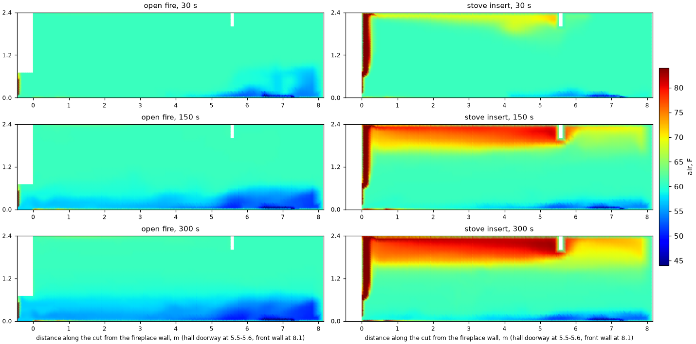

# An open fire against a stove insert in the same fireplace

An old house on a freezing evening, the central heating off, and a fire is lit in the living-room fireplace. One camp
says an open fire heats the house: "it certainly doesn't make the house colder - it throws out a surprising amount of
heat" (a Straight Dope member), and "open fireplaces don't heat air - they heat people and surfaces, radiantly" (Jim
Buckley, a fireplace builder). The other camp says its chimney cools the rest of the house: "Fireplace drafts can pull
the warm air up the chimney, causing other rooms to be cooler" (US EPA, Burn Wise), and an open fire "may actually
remove more heat from a house than [it] produce[s]" because it will "pull cold air into the house from small gaps
around windows and doors" (US DOE). This case lights the same fireplace of the same ground floor twice, once as an open
fire and once with a closed insert with a glass door in the opening, each burning at a typical real rate, and asks how
warm the air is in the rooms away from the fire over the first five minutes. It is about the air, not the radiant
warmth on someone at the hearth, not fuel, bills or smoke, and not a whole evening.

    ./Allrun open      # the open fire: 1.8 kW radiated, 0.0783 kg/s of room air up the chimney, 0-300 s
    ./Allrun insert    # the insert: 3.5 kW through its glass, 3.4 kW of warm air from its jacket, 0.0068 kg/s up the chimney

**The result.** **With the open fire the rest of the house cools; with the insert it warms, slowly.** Both houses start
at rest at 16 °C (61 °F) with 0 °C (32 °F) outside. The air in the other rooms (the hall, the study and the
kitchen-diner, from 0.10 to 1.80 m) falls from 16.00 to **14.91 °C (58.8 °F) with the open fire** by 300 s and rises to
**16.42 °C (61.6 °F) with the insert**, 1.51 K apart; at 60 s they are 0.35 K apart and at 150 s 0.63 K. The open
fire's chimney takes 0.0783 kg/s of the room's air, and 0.083-0.085 kg/s of outdoor air at 0 °C comes in under the two
outside doors to replace it, 1.6 air changes an hour, against 0.57-0.66 with the insert. That cold air runs along the
floor from the doors to the hearth, while the open fire's 1.8 kW goes as radiation into the floor, the hearth and the
sofa, which give 0.68 kW of it back to the air by 300 s. The insert's warm air climbs the fireplace wall and spreads as a
layer under the ceiling, 28.5 °C (83 °F) over the living room at 300 s, which spills under the doorways' lintels into the
other rooms. The living room's air ends at 15.22 °C (open) against 19.57 °C (insert). Read [What it
cannot](#what-it-cannot) before any number here: **the fires are not equal** (the open fire burns about twice the
wood); **both burn steadily from the first second**, with no warm-up of the insert, the bricks or the chimney; **the
open fire's flames and their hot gas are not in the model**, and both chimneys' flows are imposed; **the numbers are
air temperatures, not the radiant warmth on someone at the open fire**, which is that camp's best argument; and there
is one mesh per house and five minutes of flow.

The house, its fires and its leaks are new. The heat-storing wall condition (`src/radLayerWall`) is
[`radiatorCabinetTop`](../radiatorCabinetTop)'s, byte for byte, the fire's radiation is fvDOM, and a small radiation-only solver
(`src/radiationInit`) gives the runs their starting radiation.

*The cut the clip shows (`sectionClear`), from `scripts/plot_planes.py`: from the fireplace (left) diagonally across
the living room, under the hall doorway's lintel (the white notch at 5.5 m) and across the hall to the front wall. The
open fire's recess is the step at the far left; its throat, the chimney, is in the recess's top.*

## The house

x runs from the fireplace wall (x = 0) to the back door's wall, y up from the floor and z across the house; metres.

| | value | from |
|---|---|---|
| the ground floor | 10.8 x 6.0 m inside and 2.4 m high (65 m², 700 sq ft); 150.63 m³ of air (open) and 150.38 m³ (insert) | ours |
| living room | x 0-5.2, z 0-6.0; the fireplace in its end wall, its opening 0.90 m wide (z 2.55-3.45) and 0.70 m high; a stone hearth in front, x 0-0.6, z 2.2-3.8 (0.96 m²); a sofa facing the fire, x 2.6-3.4, z 2.0-4.0, its seat 0.4 m and its back (x 3.2-3.4) 0.8 m high, solid to the floor | ours |
| kitchen-diner | x 5.3-10.8, z 2.1-6.0, open to the living room by a doorway z 2.6-3.5 on the fireplace's line; a table top x 7.6-9.0, z 3.8-4.7, 0.7-0.8 m (no legs) and a counter x 6.8-9.6 along the back wall, 0.9 m high | ours |
| hall and study | the hall x 5.3-7.7, z 0-2.0, with the front door in its outer wall (z = 0, x 6.0-6.9); the study x 7.8-10.8, z 0-2.0 off it. The inside doorways (living room to hall z 0.6-1.5, hall to study z 0.6-1.5, and the kitchen's) are open, 2.0 m high; the inside walls 0.1 m thick | ours |
| leaks | a 2.5 cm gap under the front door and under the back door (z 2.6-3.5 at x = 10.8), 0.9 m each, and a 20 x 2.5 cm gap at the head of each of four windows (y 2.1-2.125): **0.065 m² in all**. Real leaks are narrower and more numerous; a mesh of this size cannot carry 5 mm cracks, so the gaps stand for the same leakage in fewer places. 0.065 m² on 65 m² of floor is a leaky old house | ours |
| outdoors | 0 °C (273.15 K) still air: each gap's total pressure is the outdoor air column's at its own height, so the stack effect of 16 °C inside against 0 °C outside is in both houses; air enters at 0 °C and leaves at the room's temperature | ours |
| windows | 8.28 m² of double glazing, y 0.9-2.1 m, two in the living room (one each side), one in the study and one in the kitchen; massless, a film of 4.403 W/m²K to 0 °C outside | ours |
| surfaces | walls and ceiling 12.7 mm gypsum (k 0.1587 W/m K, ρc 723,991 J/m³K), floor, table and counter 19 mm wood (0.106, 1,237,411), hearth 50 mm stone (1.7, 2,000,000), sofa 50 mm foam (0.04, 49,000), each in 24 layers with an adiabatic back, starting at 16 °C; all grey and diffuse at emissivity 0.9 | ours; over five minutes heat reaches about 8 mm into gypsum, so the walls lose nothing to outdoors |
| start | the air at rest at 289.15 K (16 °C) in hydrostatic balance, every surface at 289.15 K, and the fire already burning: the radiation at t = 0 is the converged field of the house at rest with the fire's panel or glass hot | ours |

## The two fires

Each burns at a typical real figure, and they are not equal.

| | open fire | insert |
|---|---|---|
| wood | 3.5 dry kg/h, the commonest burn rate of 557 measured cordwood fires in open fireplaces (OMNI for the EPA's AP-42), about 18 kW | about 1.8 kg/h, 9 kW at 78% |
| what is modelled | a recess 0.40 m deep behind the opening; on its back wall a **0.28 m² panel (0.7 x 0.4 m) held at 624.73 K**, emissivity 1, the glowing fire; the recess's other faces reflect (emissivity 0.1) and do not conduct | the opening **closed flush with the wall**; a **0.28 m² glass (0.7 x 0.4 m) held at 708.88 K**, emissivity 0.9; under it the jacket's intake (z 2.75-3.45, 0.07 m²) and the combustion air's (z 2.55-2.75, 0.02 m²), at the floor; over it the jacket's outlet (0.9 x 0.1 m at y 0.6-0.7) |
| heat into the room | **1.8 kW, all radiated** (10% of the fire; LBL measured that 10% is radiated to the room and the DOE says "at best ten percent"): the panel's temperature is the one that gives 1,802 W net out of the opening | **3.5 kW radiated through the glass** (the glass's temperature gives 3,500 W) **and 3.38 kW as warm air**: the jacket returns its intake's 0.041 kg/s 3,380 W warmer (about 82 K, 99 °C at the outlet). An insert maker's data sheet gives 7 kW, half through the glass and half as warm air; the jacket's 3,380 W is 3,500 W less the 120 W the glass gives the air by convection in the model |
| air up the chimney | **0.0783 kg/s** of room air out through the throat in the recess's top (0.9 x 0.15 m), 3.90 standard m³/min, the commonest of 275 measured chimneys in the same table | **0.0068 kg/s** of combustion air (the same data sheet's 6.8 g/s of flue gas) |

Neither chimney nor its flue gas is in the domain: the flows are imposed (`flowRateOutletVelocity`), and what the solve
finds is where the replacement air comes in, what it does on its way to the fire, how the heat spreads and how much of it
the surfaces take. The open fire's flames and their hot gas, 90% of its heat, go up the chimney and are not modelled;
putting a 16 kW plume in the recess would have made the run a test of whether the fireplace smokes. Giving both fires
the same 9 kW would halve the open fire's radiation to 0.9 kW and leave its chimney's flow about the same (the same table's
firelogs, 0.7 kg/h, drew 4.24 m³/min), so the choice here favours the open fire.

## The model

`buoyantPimpleFoam` (OpenFOAM v2512), air a perfect gas (molar mass 28.96, Cp 1005 J/kg K, μ 1.82e-5 Pa s, Pr 0.71,
sensible enthalpy), k-ω SST with `buoyancyTurbSource` (`constant/fvOptions`) and wall functions; `limitedLinear 1` for
momentum, energy and the turbulence terms' general scheme, bounded upwind for k and ω, Euler in time, two outer and two
pressure correctors, p_rgh by GAMG to 1e-7, adaptive steps at Courant 1 (maxDeltaT 0.05 s; about 0.016 s in practice).
The walls are `radLayerWall` (`src/radLayerWall`): each face's surface temperature solved with its 24-layer slab in one
tridiagonal system, taking the air's convection and the radiation's net flux, so every surface warms as it absorbs.
`constant/fvOptions` also holds a diagnostic that records each wall's convective flux at the energy solve; it adds and
changes nothing.

**Radiation**: fvDOM (discrete ordinates), transparent air, grey diffuse surfaces, **192 directions** (nPhi 6,
nTheta 8; an even nTheta, since an odd one gives a false flux on walls facing z), one fvDOM iteration of three
Gauss-Seidel sweeps per ray each time it is solved, **every 80 steps in the open house and every 90 in the insert's**
(about every 1.3-2.0 s of flow). fvDOM shades the doorways and the sofa's far side by itself; its weakness is the ray
effect from a small source: on the floor in front of the fire it gives 1.18 times the exact view factor's irradiation at
192 directions (1.35 at 128). Smoke and water vapour are left out.

**The starting radiation** (`scripts/init_radiation.py`, `src/radiationInit`): every surface held at 289.15 K and the
panel or the glass at its temperature, radiation alone is solved eight times with ten sweeps a ray, and its 192 ray
fields, G and qr become the runs' `0/`. The panel's and the glass's temperatures were found this way on the cloud
(a trial at 800 K, then the fourth-power rescaling to the target, then a check), and are fixed in `template/`.

**The mesh** (`scripts/make_mesh.py`): a 0.1 m background (112 x 24 x 60 cells over x -0.4 to 10.8) cut by the solids
(the walls, the fireplace wall, the sofa, the table and the counter as a union of boxes in an STL) with a castellated
`snappyHexMesh`, no snapping and no layers; refined to 0.05 m in the floor's first 0.1 m, round the fireplace (x -0.4 to
0.6, y 0-1.2, z 2.3-3.7), over it to the ceiling (the plume, x 0-0.3) and at the opening's edges, and to 0.025 m at the
gaps, so each gap is one cell high. snappy's single wall patch is then split by face centre into the 17 (open) or 19
(insert) patches the boundary conditions name, and the doorways get face zones for the monitor. **214,880 cells (open)
and 212,864 (insert)**, all boxes; `checkMesh` says Mesh OK (non-orthogonality at most 25.2°, skewness 0.33), and with
`-allGeometry` flags 7,455 concave cells at the refinement transitions, which are flat. One mesh a house, no mesh study.

**The monitor** (`system/functions`, coded function objects compiled at the first step): every step it integrates, and
every 0.625 s writes one row of `postProcessing/metrics/metrics.csv` (176 columns open, 190 insert, named in
`scripts/columns_<run>.json`): each gap's and port's flow each way, its temperature and enthalpy; the gross flows
through the three inside doorways and the open fire's opening; the air's mass and enthalpy; the coldest and warmest air
and where; each room's mean air temperature over all heights, at the ankle (y < 0.10 m), in the occupied zone (0.10-1.80
m), at seat height and under the ceiling (y > 2.2 m); every patch's convective, raw and radiative heat; and the hearth's,
floor's, sofa's and windows' surface temperatures. It also writes, every 0.625 s, seven planes of T and U (ankle, seat
and head height plans, one under the lintels, the long section z = 3.02 m through the fireplace and the sofa,
**`sectionClear`**, and one through the hall and study) and the floor's, hearth's and sofa's T and qr, as VTK; and
**the 3-D T and U every 0.625 s** (`volumeTU`, into `retainedTU/<time>` of the decomposed case, without the wall layers'
histories, so they are not restart files). The full fields are written every 30 s for restarts. Two more objects are the cloud driver's
stops, kept as run: they end the run at its next write if a file `STOP_AT_NEXT_WRITE` appears in the case, and do nothing
otherwise; and the monitor ends a run after 50 steps if a file `TEST_50_STEPS` is there, as the cloud's tests did.

## Results

`results/summary.txt` and `results/<run>/history.csv` (every 0.625 s, 0-300 s), from `scripts/extract_results.py` on the
solved runs' monitors. "The other rooms" is the hall, the study and the kitchen-diner together, volume-weighted from
0.10 to 1.80 m.

| air, °C | 5 s | 15 s | 30 s | 60 s | 150 s | 240 s | 300 s |
|---|---:|---:|---:|---:|---:|---:|---:|
| other rooms, open fire | 15.96 | 15.87 | 15.76 | 15.58 | 15.26 | 15.05 | **14.91** |
| other rooms, insert | 15.99 | 15.98 | 15.96 | 15.93 | 15.89 | 16.15 | **16.42** |
| difference, K | 0.04 | 0.11 | 0.20 | 0.35 | 0.63 | 1.11 | **1.51** |
| living room, open fire | 16.00 | 15.99 | 15.95 | 15.84 | 15.55 | 15.32 | 15.22 |
| living room, insert | 16.20 | 16.51 | 16.90 | 17.55 | 18.71 | 19.27 | 19.57 |
| living room under the ceiling (y > 2.2 m), open | 16.00 | 16.01 | 16.01 | 16.04 | 16.09 | 16.17 | 16.22 |
| living room under the ceiling, insert | 17.03 | 19.92 | 21.80 | 23.85 | 26.68 | 27.89 | 28.45 |
| the whole floor, open fire | 15.96 | 15.91 | 15.83 | 15.71 | 15.42 | 15.23 | 15.12 |
| the whole floor, insert | 16.09 | 16.22 | 16.39 | 16.72 | 17.48 | 18.05 | 18.37 |

In °F the other rooms go 61 to 58.8 with the open fire and 61 to 61.6 with the insert; the insert's other rooms dip
slightly for the first 150 s, as the stack effect of its warm ceiling draws cold air under its doors before its warm
layer reaches them.

| air and heat | open fire, 15 s | open fire, 300 s | insert, 15 s | insert, 300 s |
|---|---:|---:|---:|---:|
| outdoor air in, kg/s | 0.0852 | 0.0825 | 0.0291 | 0.0335 |
| the same in air changes an hour (1.22 kg/m³, 150.6 m³) | 1.67 | 1.62 | 0.57 | 0.66 |
| of it under the two doors, kg/s | 0.0852 | 0.0825 | 0.0291 | 0.0335 |
| house air out through the window-head gaps, kg/s | 0.0035 | 0.0032 | 0.0297 | 0.0299 |
| up the chimney, kg/s (imposed) | 0.0783 | 0.0783 | 0.0068 | 0.0068 |
| radiation into the room, W | 1,803 | 1,798 | 3,498 | 3,491 |
| air to the ceiling by convection, W | -3 | -5 | 751 | 1,741 |
| air to the walls, W | -53 | -191 | 246 | 584 |
| air to the floor, W (negative: the floor warms the air) | -360 | -676 | -156 | -456 |

**Where the air goes.** In the open house the cold air comes in under both outside doors at 0 °C and runs along the
floor, through the hall doorway and the kitchen's, to the hearth; nothing heats the open house's air directly (the fire
only radiates and the chimney removes air), so its ceiling stays at 16 °C while its floor layer cools: on the clip's
cut the hall floor is 51-53 °F from 1:15 and the living room's floor falls from 61 to 55 °F by 5:00. In the insert's
house the jacket's 99 °C air climbs the fireplace wall, fills the living room's upper metre and runs under the
lintels into the hall and the kitchen (the hall's ceiling 71 °F at 3:45); its floors cool too, less (59 °F in the
living room and 55 °F in the hall at 5:00), and its warm ceiling raises the stack effect, so it takes about 0.03 kg/s
under its doors and loses the same at the window heads.

**Is it believable?** By hand, 0.083 kg/s of 0 °C air into a 16 °C house costs about 1.3 kW of heating, against the
open fire's 1.8 kW of radiation, most of which goes into the floor, the hearth and the sofa rather than the air within
five minutes: the floor gives 0.68 kW back to the air by 300 s. LBL's 100 m² house with a fireplace measured 0.69 air
changes an hour before its fire and 2.02 during it; the open house here draws 1.62 and the insert's 0.66. In LBL's house
the heaters in the other rooms had to give 664 W more while the fire burned.

**Checks.** On the cloud: both runs ended normally at 300 s with no pressure solve at its iteration limit and no bounding
of T, h, ρ or ω; the insert run printed 136 bounding messages for k, the lowest k -2.4e-10 m²/s². The air's enthalpy
budget over 10-300 s (the fire's and the jacket's heat, the ports' and gaps' enthalpy, the surfaces' convection, against
the change in ∫ρ cp (T - 289.15) dV) closes to **-0.087% (open) and +0.023% (insert)** of the fire's nominal heat. The
radiation's own balance (what the surfaces absorb against what the panel or glass sends) is 8.4% (open) and 2.8% (insert)
out in the first seconds, as the walls start to warm between radiation solves, under 1% after 5 s, and 0.02% and 0.13%
at 300 s. The coldest air after 5 s is -0.08 °C, at a gap's inflow; the warmest is 97.8 °C, at the jacket's outlet.

## What the clip shows, and what it does not

The clip shows the cut `sectionClear`, a vertical plane through (0, y, 2.75) with normal (0.33872, 0, 0.94089), in both
houses, the open fire above and the insert below, from lighting to 5:00 of flow at a constant 15 times speed (20.04 s),
coloured by air temperature from 44 to 84 °F, under the title "Fireplace: open fire or stove insert?" with a clock of the
solve's time. The cut runs from the fireplace's opening at x = 0 (through the recess in the open house; at the glass's
edge, through the jacket's outlet and intake, in the insert's) diagonally across the living room's floor, passing 0.175 m
clear of the sofa's nearest corner, through the hall doorway under its 2.0 m lintel and across the hall to the front
wall at x = 7.64 m: 3,669 points (open) and 3,519 (insert), one unbroken sheet. **Each panel's one number is the other
rooms' air from 0.10 to 1.80 m in whole °F**: open 61 at 0:00, 60 at 1:15, 59 at 2:30 and 59 at 5:00; insert 61 at 0:00,
61 at 2:30 and 62 at 5:00. The numbers part at 0:20.

- **The front door is beside the cut, not in it**: it lies 0.25-0.56 m from the plane, so the cold air is seen arriving
  on the hall floor over a door-coloured strip labelled "front door, beside the cut", not through a door in the picture.
- **The flames, the chimneys and their chevrons are drawn**, the chevrons climbing at speeds in the ratio of the imposed
  chimney flows (0.0783 against 0.0068 kg/s). Neither flue is in the domain.
- **The parcels are drawn from the plane's in-plane velocity** after the solve; they leave out the air crossing the
  plane and are not solved particles.
- **The colour scale stops at 84 °F**: about 1.8% of the insert's cut (the plume up the fireplace wall and the glass's
  edge) is hotter and reads as the top colour.

## What it cannot

- **The two fires are not the same fire.** Each burns at a typical figure, so the open fire burns about twice the wood of
  the insert. The comparison is of two typical fires in the same fireplace, not of equal heat.
- **Five minutes of two steady fires, not an evening.** Both fires are at full output from t = 0: a real insert takes 20
  to 30 minutes to heat up, and an open fire's bricks and chimney warm over hours. Nothing here says how fast either one
  starts, how the house settles, or what an hour costs.
- **The open fire's radiant warmth on a person is not shown.** The open fire radiates 1.8 kW, most of it onto the floor,
  the hearth and the sofa; someone sitting in front of it is warmed by radiation the air temperatures do not show. That
  is the open-fire camp's best argument, and this case's numbers and the clip's colours are of the air only.
- **The flames are not modelled.** The fire is a hot panel and the chimney an imposed outflow: the open fire's 16 kW of
  hot gas, the flue's draught, its dependence on the fire and the weather, and any smoke spilling into the room are not
  solved. Both chimney flows are measured typical figures, imposed.
- **The glass gives the air too little heat directly.** On 5 cm cells the glass's convection is about 120 W, where a real
  glass door gives about 1 kW; the jacket makes up the difference so that the insert's total holds, but the split
  between the plume off the glass and the jacket's jet is the model's. The same coarse film applies to the ceiling;
  it takes 1.74 kW from the insert's hot layer at 300 s, half the jacket's heat, so too little heat into the ceiling is
  not what keeps the insert's air warm.
- **One leaky house, no wind**, the leaks as six gaps one cell high, no central heating, all inside doors open, adiabatic
  wall backs over the five minutes. A tighter house would draw less through its gaps with the open fire, and wind would
  change which gaps take the air in.
- **One mesh, RANS, a ray effect.** About 0.1 m cells with 0.05 m at the floor and the fire; k-ω SST with wall functions;
  fvDOM's 192 directions put 1.18 times the exact view factor's heat on the floor in front of the fire. No mesh,
  time-step or direction study and no uncertainty bar on the 1.51 K.
- **Air only**: no smoke, no water vapour, no participating gas in the radiation.

## Sources

- Straight Dope message board, "Do fireplaces really make the house colder?"
  (https://boards.straightdope.com/t/do-fireplaces-really-make-the-house-colder/518081), read on 24 Nov 2026: "it
  certainly doesn't make the house colder - it throws out a surprising amount of heat and can actually be uncomfortably
  hot to sit in front of once it's been going a few hours"; and on the same thread, "a fireplace will warm up the room
  it's in but make the rest of the house colder."
- Jim Buckley, rumford.com, a fireplace builder: "open fireplaces don't heat air - they heat people and surfaces,
  radiantly."
- US EPA, Burn Wise: "Fireplace drafts can pull the warm air up the chimney, causing other rooms to be cooler."
- US DOE fact sheet (archived): "they may actually remove more heat from a house than they produce. A typical,
  vertical-back fireplace with an open front is at best ten percent efficient ... They also pull cold air into the house
  from small gaps around windows and doors."
- OMNI Environmental Services for the US EPA's AP-42, Table 1.9.2, cordwood fires in open fireplaces: burn rate mode 3.50
  dry kg/h (n 557); chimney flow mode 3.90 standard m³/min (n 275); "Little heat is gained from convection or
  conduction."
- Sonderegger and Modera, Lawrence Berkeley Laboratory, electric co-heating of a 100 m² house with a masonry fireplace:
  0.69 air changes an hour before a fire and 2.02 during it; "Only the remaining 10% is actually radiated to the living
  area"; during the fire the other rooms' heaters gave 664 W more.
- A 7 kW stove insert's data sheet: over 78% efficient, 6.8 g/s of flue gas, half its heat through the glass and half as
  warm air; three other inserts of the same maker give 35 to 60% through the glass.
- The house, its rooms, furniture, leaks, windows and materials, and the outdoor 0 °C, are ours (above).

## How the case got here

**The first solve.** The subject was chosen on 24 Nov 2026 and solved on a cloud workspace of four cores by an agent,
checked by us. It built both meshes, checked fvDOM on an isothermal house (|qr| at most 0.015 W/m²), found the panel's
and the glass's temperatures (first at 128 directions, which put 1.35 times the exact view factor's heat on the floor in
front of the fire, then at 192), chose one fvDOM iteration and three sweeps from comparisons on a moving flow, ran 50-step
flow tests and a still-air insert test, timed both houses, and set the jacket's heat from the glass's measured
convection (3,500 - 120 = 3,380 W). Production ran the open house 0-300 s and the insert's from rest; a guide on the
difference between the houses stopped the insert at 90 s, and on the operator's ruling it was continued from its 90 s
write to 300 s on 26 Nov. The clip was first made as a plan at ankle height and then as the long section through the
fireplace (z = 3.02 m), which runs through the sofa; the operator asked whether the sofa blocks the cold air, which it
does in that plane only, and ruled: "Re-solve with a clear slice".

**This solve.** Both houses again from rest to 300 s, open then insert, on the same meshes with the same `0/`,
`constant/` and every setting of the first solve, the monitor unchanged, with the plane `sectionClear` and the 3-D T and U
writes added (26 Nov 2026). Its other rooms' air matches the first solve's to within 6e-6 K (open) and 5e-5 K (insert)
over all 481 monitor rows, and the clip's numbers are the same on every frame. The runs took 17,197 s (open) and 13,172
s (insert) on four cores; the whole re-solve, with its set-up, 50-step tests of the new writers and its export, took 9.00
h of the 10 h we allow a solve. None of the first solve's runs is in this folder.

**From the cloud to this folder.** The cloud's scripts were a chain (`build84.py`, `audit84.py`, `prepare84.py`,
`calibrate84.py`, `rad_compare84.py`, `adopt6.py`, then edits for production and the clear re-solve); here they are
`make_mesh.py` (the first two), `make_case.py` (the pressure part of the third) and `init_radiation.py` (the converged
192-direction start the runs used), and `template/` holds the re-solve's own dictionaries and small `0/` fields. The
utility the cloud called `rad84` is `src/radiationInit`, the same source with a comment added, and the cloud's
`radLayerWall` differs from `src/radLayerWall` only in its header comment. `system/controlDict` loads the wall library by
name instead of by the workspace's path; nothing else in `template/` differs from the solved runs' files.

**Checked from a clean copy of this folder** on 27 Nov 2026, against OpenFOAM v2512 on our machine, with the cloud
re-solve's inputs (fetched from the study) and its monitors and planes. `make_mesh.py` writes both houses' STL, mesh
report and `boundary`, `faceZones`, `neighbour`, `cellLevel`, `pointLevel` and the zone files byte for byte; the
insert's `owner` too, and its `points` and `faces` match the solved run's recorded hashes. **The open house's mesh has its
wall faces in a different order** (the same 16,240 faces' owners in another order; every other patch, the points and
the neighbours identical), most likely because the cloud's patch split ran twice on that mesh, a first version that
failed its area check and then the corrected one on its output; this folder has only the corrected one. `make_case.py`
writes `0/p` and `0/p_rgh` byte for byte, and every other file in `template/` is the solved runs' own except
`controlDict`'s library line. `init_radiation.py` gives 3,500.03 W through the glass and 1,802.00 W out of the open
fire, the cloud's figures, and every patch's absorbed radiation within 0.013 W of the solved runs' starting qr; the
insert's G and qr match the solved start to 1e-8 of their largest value, the open house's to 0.4% at a face, since only
ten Gauss-Seidel sweeps a ray are done and their partial convergence follows the 4-rank decomposition, which the face
order changes. Each house was then solved from rest to 5 s on 4 ranks (`./Allrun open 5`, `./Allrun insert 5`): the
runs took the same 323 (open) and 286 (insert) steps as the cloud's to 5 s with the same time steps to four or more
digits, and at the eight monitor rows 0.625-5 s **the other rooms', the living room's and the whole floor's mean air
temperatures are the cloud's to within 1e-7 K (open) and 7e-6 K (insert)**, the outdoor air coming in to within 3e-6
kg/s, the ceiling's, walls' and floor's convection and the panel's and the glass's radiation to within 0.01 W, and the hottest and coldest air to
within 2e-4 K; the windows' and the sofa's surface temperatures, the most sensitive, to within 0.002 K. On the cut
`sectionClear` the same 3,669 and 3,519 points carry T within 0.003 K and U within 6e-5 m/s of the cloud's at 0.625, 2.5
and 5 s. That is the round-off of a different machine, and in a turbulent buoyant flow it grows; a rebuilt 300 s run
should be expected to agree with these results to a few hundredths of a kelvin, not to the last digit. No full rebuilt
run was solved. `scripts/extract_results.py` on the solved runs' monitors gives the study's own figures (the other
rooms' 14.9057 and 16.4187 °C at 300 s).

## Running it

You need [OpenFOAM](https://www.openfoam.com) v2512 or near it with MPI and `wmake`, Python 3 with NumPy (and pandas for
`extract_results.py`, pyvista and matplotlib for `plot_planes.py`).

    cd cases/openFireVsInsert
    ./Allrun open                 # [endTime [nProcs]]: 300 s and 4 ranks by default
    ./Allrun insert
    python3 scripts/extract_results.py runs results
    python3 scripts/plot_planes.py runs results/sectionClear.png 30 150 300

The first `Allrun` compiles `src/radLayerWall` into `$FOAM_USER_LIBBIN` and `src/radiationInit` into
`$FOAM_USER_APPBIN`. Each run builds its own mesh in `runs/<run>/` (`scripts/make_mesh.py`: blockMesh, snappyHexMesh,
the patch split, `checkMesh`; it stops if any patch's area is more than 1% off), writes its case (`scripts/make_case.py`),
solves its starting radiation (`scripts/init_radiation.py`, a few minutes on 4 ranks; it stops if the panel's or the
glass's radiation into the room is more than 1% off 1,800 or 3,500 W), samples the planes at t = 0, decomposes (scotch)
and solves 0-300 s in one segment, as the solved runs did. `./Allrun --setup-only <run>` stops before the solve, and
`./Allrun --no-volume <run>` leaves out the 3-D T and U writes. `./Allclean` removes the runs. The solved runs took 4.8 h
(open) and 3.7 h (insert) of wall time on 4 cores each.

Each run writes the full fields every 30 s (the last three kept), the monitor's CSVs, about 3.5 GB of 3-D T and U over
300 s (7.3 MB a write), and its planes and surfaces as ASCII VTK every 0.625 s, about 4.3 GB (the cloud gzipped them to
1.2 GB a run). Our machine solved the first 5 s in about 13 (open) and 11 (insert) minutes of wall time on 4 ranks each,
with the two runs sharing it.
`results/` holds the summary, each run's history every 0.625 s and the picture above; no fields, meshes, planes, monitors
or logs. The files in `results/` are what `scripts/extract_results.py` and `scripts/plot_planes.py` wrote from the
solved runs' monitors and planes.
