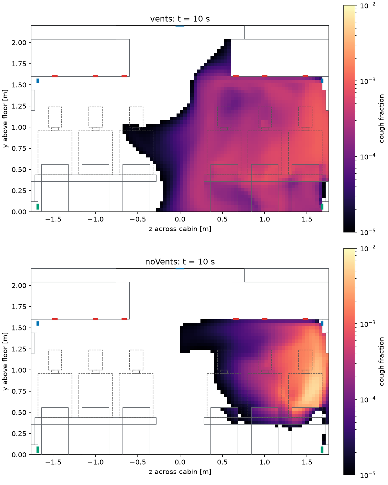
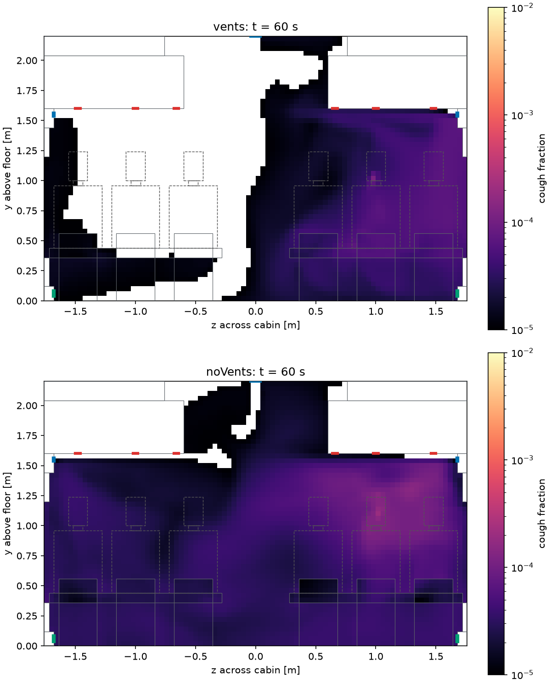

# A plane cabin's overhead air nozzles open or shut, and where one cough's air goes

You are in an economy seat in cruise and the passenger in the middle seat next to you coughs. Above the row are the
six small round air nozzles, one per seat. Travel advice often says to keep yours open and aimed just in front of
your face ("it is incredibly important to ventilate", Dr Mark Gendreau, quoted in 2017); tests that released a
tracer aerosol in two widebody airliners (the US Transportation Command's, August 2020) found that whether
the overhead nozzles were on or off made no significant difference to their measurements. This case answers a
narrower question than either: with that row's six nozzles open, and with them shut, where does the air of one
ordinary cough go in the first minute? It follows the coughed air as a passive tracer. **It says nothing about
health, infection or safety, and nothing about what anyone breathes in**; it only describes where the air and the
tracer go.

    ./Allrun vents       # the cougher's row with its six overhead nozzles open, 1.2 L/s each, 0-60 s from the cough
    ./Allrun noVents     # the same row with the six nozzles shut

**The result.** **With the row's nozzles open, the cough's air leaves the cougher's row about twice as fast: 12.7% of
it is still in the row 60 s after the cough, against 25.0% with them shut**, and half of it has left the row by 21.6 s
open against 37.0 s shut. Open, the six jets carry it down and outwards on the cougher's side to the exhaust low on
that side wall, which takes 55.0% of it by 60 s (8.3% by the other one), and only 7.1% reaches the row behind; shut,
it rises with the passengers' warmth, spreads across the aisle and back, and the two exhausts take 19.1% and 18.1%
while 21.5% is in the row behind at 60 s. Read [What it cannot](#what-it-cannot) before any number here: **the jets
on this mesh carry 1.5 to 2.2 times the published momentum at 0.48 m below the nozzle**, so they stir the row more
than real nozzles at 1.2 L/s would and the open row's figure is flattered (the direction of the difference is not
in doubt, its size is); **the passengers are boxes**; **it is one cough in one passage of an unsteady flow, with no
repeats**; and the cough's spreading rests on **k-omega SST**, a RANS model.

*The cough's air as a fraction of the air, averaged over the space between the cougher's seat back and the seat back
in front of it (x 1.20-1.72 m), at 10 s (top pair) and 60 s (bottom pair), nozzles open above and shut below in each,
on a log scale from 10^-5 (black) to 10^-2. The section is seen from behind, looking forward, so the cougher (the
middle seat, z = 1.0 m) is on the right. White cells hold less than 10^-5 or are solid. Drawn: the bins, the
passengers (dashed), the seats, the nozzles (red), the side supply slots (blue) and the exhausts (green). From the
cloud's `results/comparison_10s.png` and `comparison_60s.png`.*

## The cabin

Three seat rows of a single-aisle economy cabin in cruise, full, six seats across. x runs forwards (the passengers
face +x), y up from the floor, z across, z > 0 being the passengers' right; metres. The two ends are a translational
cyclic pair, so the cabin goes on fore and aft. All of it is in `scripts/geometry.json`.

| | value | from |
|---|---|---|
| section | x 0-2.40 (three rows at 0.80 m, 31.5 in, pitch), y 0-2.20, z -1.76 to 1.76; **12.89 m³ of air**. Side walls step in at the floor, the dado and the top; bins z beyond ±0.60 with their underside at y 1.60, closed above by coves; aisle 0.56 m | a common single-aisle section (3.54 m trim to trim, 2.20 m high, bins 1.16 m apart and 1.58 m up, aisle 0.51 m) brought to a 4 cm grid |
| passengers | 18 seated boxes (head, neck, torso, thighs, shins), head tops at 1.24 m, each block's seat backs a contiguous slab to 1.12 m and its cushions to 0.44 m; **each passenger gives the air 40 W** through its surface (720 W in all, uniform flux) | about half the 75 W sensible heat used in the mock-ups, the rest radiated; the shapes ours |
| supply | **9.4 L/s a passenger, 169.2 L/s in all, at 19.3 °C (292.45 K)**: a 2 cm slot along the top of each side wall (y 1.54-1.56) blowing inwards at 1.48 m/s, 0.07105 m³/s each (84%), and the centre of the ceiling 0.02707 m³/s downwards (16%) through an 8 cm strip, with a 0.0539 N downward force in the cells under it that gives it the momentum of the real two 4 mm slots at 2.36 m/s; mass flows imposed at 0.8964 kg/m³ | ASHRAE 161's recommended total; the split and the arrangement from You et al. (2019); 1.48 m/s against 1.42 and 1.44 m/s measured at real side diffusers |
| exhaust | a 4 cm slot low on each side wall (y 0.04-0.08), at the still air's hydrostatic pressure face by face, `inletOutlet` for T, k, ω and the tracer | You et al. (2019) |
| air changes | 47 an hour of the section's air | |
| pressure | 75,262 Pa at the floor, an 8,000 ft cabin | the certification limit for a cabin in cruise (14 CFR 25.841) |
| walls, seats, floor | adiabatic, no radiation | ours |

## The nozzles, and why the case is 3-D

A slot in a 2-D section would turn six round jets into six curtains the length of the plane, so the cabin is 3-D and
the nozzles are six separate jets over the middle row only, x 1.30-1.34 under the bins at y 1.60, 12 cm in front of
each passenger's face. The window and middle seats' nozzles point straight down. The aisle seats' heads are outside
the bins, so their nozzles sit 14 cm outboard under the bin (|z| 0.64-0.68) and point 14.5° towards their passenger.

**Each open nozzle passes 1.2 L/s** (1.0757e-3 kg/s), the upper part of the 0 to 1.5 L/s range, through a 4 x 4 cm
face. A real nozzle is a 12.6 mm ring of 33.4 mm² with lips at about 36 m/s, which no mesh that fits the budget can
hold. So **a force on the air in the 4 x 4 x 4 cm of cells under each face (`vectorSemiImplicitSource` in
`constant/fvOptions`) gives the jet its momentum**, one number for all six, fitted on this mesh in still isothermal
air (0-4 s, the mean over 2-4 s, the six jets' mean along their own axes) to the measured axis speed of a 1.2 L/s
cabin nozzle, 0.83/s m/s at s m below it between 9 and 58 cm (You et al. 2016), which is 1.73 m/s at 0.48 m. The
fit is downstream rather than at the lips because the ring loses part of its momentum before it becomes a round
jet. **0.030463 N a nozzle** gives 1.718 m/s at 0.48 m (-0.7%), 81% of the lips' momentum:

| along the axis, m | 0.20 | 0.30 | 0.40 | 0.48 | 0.55 |
|---|---:|---:|---:|---:|---:|
| measured, 0.83/s, m/s | 4.15 | 2.77 | 2.08 | 1.73 | 1.51 |
| the four straight jets here | 3.37 | 2.61 | 2.05 | 1.73 | 1.53 |
| the two tilted jets here | 3.08 | 2.42 | 1.96 | 1.69 | 1.50 |

**But the jet on this mesh is wider than a real round jet**: at 0.48 m its half-width is 5.8 to 7.1 cm against about
4.8, so at the fitted speed it carries about 1.5 to 2.2 times the momentum of the published decay curve there, and it
stirs the row more than a real nozzle would. Near the nozzle it is wider and slower than the real one; the 2 cm cells
cannot hold its first 25 cm. Shut, a nozzle is a wall with no force. Only the middle row's nozzles change; the other
rows have none open in either run.

## The cough

The passenger in the middle seat of the block at z > 0 (P2B, z = 1.0) coughs once at t = 0, forwards and 27.5° down,
uncovered, through a 2 x 2 cm mouth on the front of the head (x 1.20, y 1.05-1.07, z 0.99-1.01): **0.7 L in 0.4 s, peaking at
3.7 L/s and about 10 m/s at 0.076 s**, Gupta et al.'s (2009) cough profile as Zee et al. (2021) used it in a
single-aisle cabin (`scripts/cough_flow.csv`, normalised to exactly 0.7 L by its own piecewise-linear integral). The
coughed air is 34 °C and carries a tracer at 1. It stands for the cough's air and the smallest particles carried with
it; larger drops fall and are not in it. An ordinary cough: Chen et al. (2014) measured 12.6 m/s on average at the
peak for 25 men.

**The tracer** (`cough`) is OpenFOAM's `scalarTransport` function object, carried with the mass flux, its
diffusivity the laminar part (alphaD 1) plus the turbulent part (alphaDt 1.1765, a turbulent Schmidt number of 0.85),
`limitedLinear01` convection, unclipped. It does not feed back on the flow. **The two 4 cm cell layers at the cyclic
ends (x < 0.04 and x > 2.36) hold it at 0**, so that cough air leaving fore or aft cannot come back round from the
other end; what they take is counted as the remainder of the tracer account.

## The model

`buoyantPimpleFoam` (OpenFOAM v2512), air a perfect gas (molar mass 28.96, Cp 1005 J/kg K, μ 1.82e-5 Pa s, Pr 0.71,
enthalpy referenced at 296.45 K), **k-ω SST** with `buoyancyTurbSource`, low-Re wall functions for k and standard ones
for ω, ν_t and α_t; `limitedLinear 1` for momentum, energy and the turbulence terms' default, bounded upwind for k and
ω, Euler in time, two outer and two pressure correctors, p_rgh by GAMG to 1e-7 (relTol 0 and at most 100 iterations
in the final solve). Steps at Courant 1 (2 in the pre-run), at most 0.02 s; inlets' k at 10% intensity and ω from a
2 mm (side slots, nozzles) or 5 mm (ceiling) mixing length.

**The time-step guard** (`src/timeStepGuard`, the cloud's library `boundedWriteTimeStep86`, loaded by
`system/functions`): each step it takes the smaller of the solver's step and the Courant limit from the current
fluxes, lands the steps exactly on the write times (and, in the cough runs, on the planes' times, every 0.025 s to
3 s and 0.125 s after), and in the cough's first 0.4 s keeps the mouth's flow to 1% of a mouth cell a step. It was
written when the solver's own write alignment had raised one step to Courant 1.44 in a test.

**The mesh** (`scripts/make_mesh.py`): a 60 x 55 x 88 box of 4 cm cells less every cell inside the solids, then
castellated `snappyHexMesh` refinement only (no snapping, no layers): 2 cm in each nozzle's column (y 0.80-1.60), the
side slots, the exhausts and the cough's path (x 1.20-1.72, y 0.72-1.16, z 0.84-1.16), 1 cm at the mouth. Every solid
is a box on the 4 cm grid, so the walls are flat faces with no stairs. The boundary faces are then split into the
patches by the rectangles in `geometry.json` (each rectangle's area checked to 1%), and the ends made cyclic.
**257,061 hexahedra**, `checkMesh`: Mesh OK, non-orthogonality at most 25.2° (at the refinement interfaces), skewness
at most 0.33. One mesh, no mesh study.

**The runs** each go in three stages, each carrying the last one's fields:

1. **The pre-run**, shared: 0-70 s from rest, air at 296.45 K and hydrostatic, every nozzle shut, Courant 2.
2. **The 20 s after it**, 70-90 s at Courant 1: in `vents` the six nozzles open, their flow and force ramped up over
   the first 0.5 s, so that the jets are set up before the cough; in `noVents` the flow just carries on.
3. **The cough**, its clock set back to 0, 0-60 s from the 90 s state.

The carried fields are the last time's p, p_rgh, φ, U, T, k, ω, ν_t and α_t, byte for byte, with only the boundaries
that change (the opened nozzles; the mouth's cough) taken from the new set-up; ρ is written from the carried p and T
by the solver's own thermodynamics.

**The monitor** (`system/functions`'s `metrics`, a coded function object) appends a row to
`postProcessing/metrics/metrics.csv` every step: the mass, enthalpy and tracer in the air; every patch's gross mass
flow each way, temperature, enthalpy and tracer; the cough's released tracer and volume and what each exhaust has
taken; the tracer in the cougher's row and its parts, the rows ahead and behind and five height bands; each
passenger's mean tracer, speed and temperature; each jet's axis speed at 0.20-0.55 m; the largest Courant number and
where; and the force each momentum source delivers, read back from the solver's own fvOptions matrix. Its columns
are named in `scripts/metrics_columns.json`. The cough runs also write the clip's planes (the nozzles' plane x =
1.33, a plan at the mouth's height and a lengthwise section through the mouth, every 0.125 s and every 0.025 s for
the first 3 s, gzipped VTK), three more cross-sections every 0.5 s, four maps of the cough (`postProcessing/maps`),
the tracer's extremes and its negative part every step.

## Results

`results/summary.txt` and `results/<run>/history.csv` (every 0.5 s), from `scripts/extract_results.py` on the solved
runs' monitors. Every share is a percentage of the tracer the cough released in that run (5.970e-4 kg with the
nozzles open, 5.969e-4 kg shut: 0.69958 and 0.69941 L of coughed air). "The row" is the cougher's row's whole
section, x 0.92-1.72.

| share of the cough's air, % | 1 s | 3 s | 5 s | 10 s | 20 s | 30 s | 45 s | 60 s |
|---|---:|---:|---:|---:|---:|---:|---:|---:|
| in the row, nozzles open | 100.1 | 96.0 | 89.3 | 82.0 | 54.6 | 34.6 | 21.6 | **12.7** |
| in the row, shut | 100.1 | 100.1 | 99.9 | 95.9 | 75.4 | 63.5 | 40.0 | **25.0** |
| row ahead, open / shut | 0 / 0 | 4.4 / 0 | 11.3 / 0.2 | 15.5 / 3.0 | 13.3 / 7.4 | 10.0 / 5.7 | 5.7 / 4.4 | 3.8 / 2.6 |
| row behind, open / shut | 0 / 0 | 0 / 0 | 0.1 / 0 | 1.5 / 1.0 | 7.1 / 17.2 | 9.6 / 22.6 | 8.1 / 23.3 | 7.1 / 21.5 |
| the row's aisle, open / shut | 0 / 0 | 0.1 / 0 | 0.2 / 0 | 6.5 / 0.3 | 6.1 / 11.4 | 4.0 / 7.9 | 3.2 / 6.9 | 1.8 / 4.6 |
| the row's other block, open / shut | 0 / 0 | 0 / 0 | 0 / 0 | 0.3 / 0 | 2.2 / 3.7 | 2.7 / 10.5 | 2.8 / 7.4 | 2.3 / 6.5 |
| out, the cougher's side, open / shut | 0 / 0 | 0 / 0 | 0 / 0 | 1.7 / 0.4 | 20.3 / 0.5 | 35.4 / 3.3 | 47.6 / 12.7 | **55.0 / 19.1** |
| out, the other side, open / shut | 0 / 0 | 0 / 0 | 0 / 0 | 0 / 0 | 0.3 / 0 | 2.3 / 4.1 | 5.7 / 12.8 | 8.3 / 18.1 |
| taken at the cyclic ends, open / shut | -0.1 / -0.1 | -0.4 / -0.1 | -0.6 / -0.2 | -0.7 / -0.3 | 4.4 / -0.5 | 8.2 / 0.7 | 11.3 / 6.8 | 13.1 / 13.8 |

**Half the cough's air has left the row by 21.6 s with the nozzles open and 37.0 s shut.** With them open, the
cougher's own jet meets the cough within the first second and the row's air is moving from the start: by 5 s a tenth
of the cough has been pushed forwards into the row ahead and only 31% of it is still below 0.96 m (86% shut), by
10 s a quarter of it is in the lowest 0.4 m, and from then on it leaves mostly by the exhaust on its own side. With
them shut it hangs in front of the cougher for several seconds (86-88% of it between 0.4 and 0.96 m up to 5 s),
rises over the heads (half of it above 0.96 m at 10 s), crosses the aisle (the other block holds up to 10.5% at
30 s) and is drawn back into the row behind, from which both exhausts take it about equally. Across the maps of the cough between the rows, the
two runs differ by more than a factor of two on 80% of the cells that hold any of it at 1 s, 92% at 3 s, 87% at 10 s,
56% at 30 s and 61% at 60 s. The last row of the table is the remainder of the tracer account (released less what
is in the air and what left by the exhausts), so it also carries the account's small numerical residual, which is
why it reads slightly negative early.

With the nozzles open the six jets add 6.45 g/s of air at 19.3 °C, and the exhausts pass 79.0 g/s each against
76.2 and 75.5 shut; the side slots (127.4 g/s) and the ceiling (24.3 g/s) are the same in both.

**Is it believable?** With 47 air changes an hour of the section's air, the row's air turns over in about a minute,
so a quarter of the cough still in the row after 60 s with the nozzles shut is about what mixing alone gives, and an
eighth with six jets stirring it down to the near exhaust fits. The direction matches the laboratory and cabin
studies' finding that a nozzle aimed down at the seat carries a contaminant from the face towards the floor and the
near exhaust, and also their finding that a nozzle's effect can go either way with its aim and flow (You et al.
2017; Li et al. 2016). The known bias is the jets' momentum (above): it makes the open row's difference somewhat
larger than real; it does not reverse it.

**Checks.** On the cloud: both cough runs ended normally at 60 s (20,620 steps with the nozzles open, 5,087 shut); no
final pressure solve ended above 1e-7 and none at its iteration limit; no bounding; Courant at most 1.00. Each started
from its own 90 s state without a jump (the largest speed 5.43 to 5.41 m/s open, 1.468 to 1.471 shut; the exhausts'
temperature within 0.0002 and 0.001 K). The supplies' mass flows are exact; the momentum each source delivers is the
stated newtons to 1e-14; the heat budget (720 W from the passengers against the enthalpy carried out and stored)
closes to within 0.3-0.9 W at every reported time. The tracer is not clipped: its most negative value anywhere was
-0.0052 in the first 0.1 s of a test cough, and the largest negative tracer mass in either run was 2.1e-9 kg,
0.00035% of the release.

## What the clip shows, and what it does not

The clip shows the whole cabin section seen from the front, looking aft, nozzles open above and shut below, under the
title "Plane air vent: on or off?" with a clock running from the cough. The colour is the cough's air through the
space between the cougher's row and the row in front (`postProcessing/maps/<time>/gap_yz.bin`), from "a trace" to
"dense" on a log scale from 1e-5; the air's motion is drawn from the nozzles' plane. It runs 0-60 s without a cut,
the first second slowed so that the 0.4 s cough spans several frames, then at three times real speed. **Each
panel's one number is the share of the cough's air still in the cougher's row**, rounded: 100% in both at the
start, 13% open and 25% shut at 60 s.

- **From the first frame the panels differ**: six lit nozzles and their jets above, still air below. The cough
  appears in both at 0.3-0.5 s; by 1 s it is carried down and outwards by the jets above and hangs as a ball at the
  cougher below.
- **In the last 20 s both cabins are a similar haze** at the colour scale's low end, which starts at 1e-5 so that
  the spread across the aisle shows; the numbers carry the difference there more than the colour does.
- **Seen from the front, the cougher is on the viewer's left** (the pictures above are from behind).
- **Nothing about health.** The clip, like this README, says where the air goes and nothing about infection,
  risk or safety, and does not tell anyone to use the nozzle.

## What it cannot

- **The jets are too strong for their flow.** Fitted to the measured speed at 0.48 m on a mesh that makes them wider
  than real, they carry 1.5 to 2.2 times the published momentum there, and stir the row more than real nozzles at
  1.2 L/s would. The open row's 12.7% is flattered by this, by an amount not measured here. 1.2 L/s is itself at the
  high end; a half-open nozzle (0.66 L/s in the papers) would be a weaker effect.
- **One cough, one direction, one flow, no repeats.** The flow in a full cabin is unsteady: another cough a few
  seconds later, or the same cough in another seat, could go elsewhere, and nothing here is averaged over repeats.
  The nozzles point straight down in front of each face (the aisle ones 14.5° inwards) and the papers find that
  direction and flow can turn the effect either way; this is one setting. The other rows' nozzles are shut in both.
- **Boxes for passengers**, seated still, with no breathing, no bags, tray tables, window shades or crew walking;
  40 W each spread evenly over the box. Walls are adiabatic and there is no radiation.
- **RANS.** The spreading of the cough's air is k-ω SST's turbulent diffusion on 2 cm cells (1 cm at the mouth), not
  resolved eddies. No mesh, time-step or turbulence-model study, and no uncertainty bar on 12.7 or 25.0%.
- **Air, not droplets.** The tracer is the coughed air and what follows it exactly; large drops, evaporation and
  deposition are not modelled, and nothing is said about what reaches anyone's breathing.
- **Three rows, periodic.** The cabin repeats every three rows, the cyclic ends' layers remove the tracer, and the
  supply and exhaust are uniform along the cabin.

## Sources

- You R, Chen J, Shi Z, Liu W, Lin C-H, Wei D, Chen Q, "Experimental and numerical study of airflow distribution in
  an aircraft cabin mock-up with a gasper on", Journal of Building Performance Simulation, 2016: a 1.2 L/s nozzle in
  a single-aisle mock-up by PIV, the 12.6 mm ring, its axis speed 0.83/s (eq. 4), 1.44 m/s at the side diffusers;
  k-ω SST the better model where the jet dominates.
- You R, Lin C-H, Wei D, Chen Q, "Evaluating the commercial airliner cabin environment with different air
  distribution systems", Indoor Air 29:840-853, 2019: the supply's arrangement (two 4 mm ceiling slots at 2.36 m/s,
  a 20 mm slot atop each side wall, exhausts low on the side walls), 19.3 °C supply, seated head height.
- You R, Chen J, Lin C-H, Wei D, Chen Q, "Investigating the impact of gaspers on cabin air quality in commercial
  airliners with a hybrid turbulence model", Building and Environment 111:110-122, 2017: the nozzles' effect neutral
  overall and dependent on their setting; 75 W sensible a passenger.
- Li B et al., "Experimental studies of thermal environment and contaminant transport in a commercial aircraft cabin
  with gaspers on", Indoor Air 26:806-819, 2016: nozzle flows 0 to 1.5 L/s, 0.66 L/s half open, 1.42 m/s at the side
  diffusers.
- Shi Z, Chen J, You R, Chen C, Chen Q, "Modeling of gasper-induced jet flow and its impact on cabin air quality",
  Energy and Buildings 127:700-713, 2016.
- Gupta JK, Lin C-H, Chen Q, "Flow dynamics and characterization of a cough", Indoor Air 19:517-525, 2009, as used by
  Zee M et al., "Computational fluid dynamics modeling of cough transport in an aircraft cabin", Scientific Reports
  11:23329, 2021 (peak 3.67 L/s, 0.7 L, a 4 cm² mouth 27.5° below the horizontal, cut at 0.4 s); Chen et al. 2014 for
  the measured peak speeds of coughs.
- ASHRAE Standard 161, *Air Quality within Commercial Aircraft*: 9.4 L/s a passenger. 14 CFR 25.841: an 8,000 ft
  cabin.
- Silcott D et al., *TRANSCOM/AMC Commercial Aircraft Cabin Aerosol Dispersion Tests*, US Transportation Command and
  Air Mobility Command, tests of August 2020, p. 30, on the overhead supply on or off.
- Dr Mark Gendreau, quoted in US travel and news media, September 2017: keep the nozzle on at
  low or medium, aimed so that the air falls slightly in front of the face.
- The section's dimensions are a common single-aisle airliner's, from a published airport-planning drawing, brought
  to a 4 cm grid; the passengers' shapes, the 40 W split, the 1.2 L/s setting and the nozzles' aim are ours (above).

## How the case got here

**The solve.** The subject was chosen on 25 Nov 2026 and solved on a cloud workspace of four cores by an agent, checked
by us. Before any run, the first geometry was found to have the aisle seats' nozzles in the open air beside the bins;
they were moved under the bins and tilted to their passengers, the mesh was rebuilt, and nothing had run on the wrong
one. Then: the nozzle force was fitted in still air (two attempts, 0.0126 N then 0.030463 N), and short tests checked
the supplies' flows, the mass balance, the forces, the passengers' 720 W, still air at rest (0.0012 m/s) and a 0.5 s
cough from still air (0.69889 L through the mouth; tracer released 0.16% under 0.7 L times the mouth's density; its
range -0.0052 to 0.994). A first production launch died on an MPI option clash before any step. The second ran the
pre-run to 70 s, where the state was found not to have been written (70 s was not a write time), so 60-70 s was
solved again from the 60 s write and every stage was given its end-of-run write (`endCheckpoint`); it then ran the
shut run's 70-90 s and was killed during the open run's 70-90 s; a retry under its own
budget re-ran that stage from the verified 70 s state and then both cough runs to 60 s, in 5.56 h of wall time on
four cores (the open cough run 3.5 h, the shut one 0.9 h). During the retry a gate on the tracer's negative mass
"under 0.5% of the tracer released so far" was changed to logging only, after it had stopped the open run on its
first step when almost nothing had been released; against the whole release the negative mass stayed at 0.00035%.

**From the cloud to this folder.** The cloud's mesh scripts `build_mesh.py`, `audit_mesh.py` and `finalise_mesh.py`
are `scripts/make_mesh.py`, with their paths changed and their ledger and renders left out; its
`snappyHexMeshDict` is `template/mesh/system/snappyHexMeshDict` as it wrote it, and `fvSchemes` and `fvSolution`
beside it are the earlier house case's that it copied. The set-up part of its `prepare.py` and the field carry of its
production controllers are `scripts/make_case.py`, with the fitted force written in. `template/` holds the solved runs'
own `constant/` and `system/` files: `template/pre/system/functions` is the pre-run's and the 70-90 s stage's, and
`template/run/system/` the cough runs' (`functions`, `planesT0`, `mapsT0`, `writeRho`), changed only in loading the
time-step guard by name instead of by the workspace's path and in the end-of-run write (`endCheckpoint`), which now
also fires when the solver stops less than half a step short of endTime, as a short test's growing steps do; in the
solved runs every stage ended exactly on its endTime and wrote there, which it still does. `src/timeStepGuard` is the
cloud's library, its sources byte for byte, `Make/files` building into `$FOAM_USER_LIBBIN`.
`scripts/extract_results.py` and `scripts/metrics_columns.json` are new (the cloud named the monitor's columns in
its analysis script). Left out: the cloud's tests, its nozzle-fit runs, its reports and clip exports, and its
continuation gate after the 70-90 s stage (the largest speed under 12 m/s and the exhausts at 294-301 K; both solved
stages passed it).

**Checked from a clean clone of this repository** on 27 Nov 2026, against OpenFOAM v2512 on our machine.
`scripts/make_mesh.py` writes the same `topoSetDict` and `createPatchDict` as the cloud, byte for byte, and a mesh of
257,061 cells and 12.891648 m³ whose boundary (every patch's faces and start) is the solved runs' and whose cell
centres and volumes are the cloud's to the last bit; `checkMesh`: Mesh OK, non-orthogonality 25.24°, skewness 0.333,
in 1.5 minutes on one core. The whole chain then ran on four cores as a short test, `./Allrun vents 0.01 4 0.01 0.02`
(pre-run to 0.01 s, the nozzles opening over 0.01-0.02 s, the cough 0-0.01 s) and `./Allrun --no-planes noVents 0.01
4 0.01 0.02` from the same pre-run: every stage ended normally and carried its fields on; in the open cough run the
supplies passed 0.0636892, 0.0636892 and 0.0242655 kg/s, each nozzle 1.07568e-3 kg/s, each nozzle's force 0.030463 N
(the aisle ones tilted 14.5°) and the ceiling's 0.0539 N, the passengers 720 W, the first step was 5.95e-4 s as on the
cloud, and the cough had begun to release its tracer; in the 70-90 s stage the nozzles' flow and force ramped up from
zero as they should. No full-length run was solved here, so the results are the cloud's.

## Running it

You need [OpenFOAM](https://www.openfoam.com) v2512 or near it with MPI and `wmake`, and Python 3 with NumPy.

    cd cases/planeAirVent
    ./Allrun vents                # [endTime [nProcs [prerunEnd [coughAt]]]]: 60 s, 4 ranks, 70 and 90 s by default
    ./Allrun noVents              # reuses the pre-run that the first run solved
    python3 scripts/extract_results.py runs results

The first `Allrun` compiles `src/timeStepGuard` into `$FOAM_USER_LIBBIN`, builds the mesh in `runs/mesh`
(`scripts/make_mesh.py`, about 1.5 minutes) and solves the shared pre-run in `runs/prerun`, 0-70 s; each run then
solves `runs/pre_<run>`, 70-90 s, and `runs/<run>`, the cough, 0-60 s (`scripts/make_case.py` writes each stage from
the last one's reconstructed fields). When both runs have reached 60 s it writes `results/`. `./Allrun --setup-only
vents` stops after decomposing the pre-run; `./Allrun --no-planes <run>` leaves out the clip's planes and maps; a
quick test of the whole chain is `./Allrun vents 0.01 4 0.01 0.02`. Set `MPIRUN_OPTS` (default `--bind-to core
--map-by core`) to place the ranks, for example `MPIRUN_OPTS="--cpu-set 4,5,6,7 --bind-to core"`. `./Allclean`
removes the runs.

On four cores the cough run took about 3.5 h with the nozzles open (the cough's first 0.4 s and the jets keep the
steps near 3 ms) and 0.9 h shut. It writes the full fields every 20 s (about 30 MB each), the monitor's CSV (about
60 MB), and the planes and maps, about 0.5 GB a run gzipped. Two solves of an unsteady flow on different machines or
decompositions drift apart in their details; how closely a rebuilt run's shares would agree with these was not
measured here. `results/` holds the summary, each run's shares every 0.5 s and the pictures
above; no fields, meshes, planes, maps or logs.
